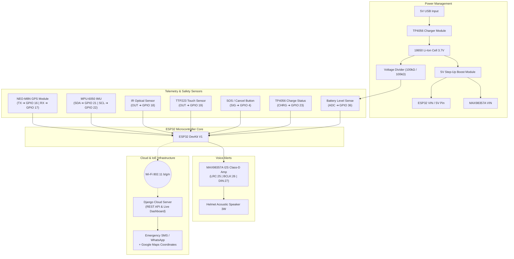

# 🔌 Kavach Smart Helmet — Complete Circuit & Schematic Diagram Guide
### IoE-Based Smart Helmet with Navigation, Speed Monitoring & Accident Detection

---

## 📌 1. Master GPIO Pin Mapping Table

| Component | Component Pin | ESP32 Pin | Signal Type | Description / Hardware Notes |
| :--- | :--- | :--- | :--- | :--- |
| **NEO-M8N / NEO-6M GPS** | `VCC` | `3.3V` / `5V` | Power | High-sensitivity Multi-GNSS receiver |
| | `GND` | `GND` | Ground | Common system ground |
| | `TX` (GPS Data Out) | `GPIO 16 (RX2)` | Digital UART | NMEA sentence stream into ESP32 HardwareSerial(2) |
| | `RX` (GPS Data In) | `GPIO 17 (TX2)` | Digital UART | Configuration / commands to GPS |
| **MPU-6050 6-DOF IMU** | `VCC` | `3.3V` | Power | 3-Axis Gyroscope + 3-Axis Accelerometer |
| | `GND` | `GND` | Ground | Common system ground |
| | `SDA` | `GPIO 21` | I2C Data | Fast I2C serial data line |
| | `SCL` | `GPIO 22` | I2C Clock | I2C clock line |
| | `AD0` | `GND` | Address Select | Sets I2C address to `0x68` |
| **IR Proximity Sensor** | `VCC` | `3.3V` | Power | Optical detection for helmet wear |
| | `GND` | `GND` | Ground | Common system ground |
| | `OUT` | `GPIO 18` | Digital In | `LOW` = Head Detected (Worn); `HIGH` = Removed |
| **TTP223 Capacitive Touch** | `VCC` | `3.3V` | Power | Head contact capacitive sensor |
| | `GND` | `GND` | Ground | Common system ground |
| | `OUT` | `GPIO 19` | Digital In | `HIGH` = Head Touched / Strapped |
| **SOS / Cancel Push Button** | Terminal 1 | `GPIO 4` | Digital In | Active `LOW` with ESP32 internal pull-up |
| | Terminal 2 | `GND` | Ground | Common system ground |
| **MAX98357A I2S Amp** | `VIN` | `5V` (Boost Rail) | Power | 3.2W Class-D amplifier power |
| | `GND` | `GND` | Ground | Common system ground |
| | `LRC` / `WS` | `GPIO 25` | I2S Word Select | Left/Right Word Clock |
| | `BCLK` | `GPIO 26` | I2S Bit Clock | Serial Audio Bit Clock |
| | `DIN` | `GPIO 27` | I2S Data In | Digital PCM Audio Stream |
| | `GAIN` | `GND` | Config | Tied to GND for +12dB audio gain |
| | `SD_MODE` | Unconnected | Config | Leave floating for mono mixed `(L+R)/2` |
| | `SPK+` / `SPK-` | Helmet Speaker | Analog Out | 4Ω (3W) or 8Ω (1.5W-3W) speaker |
| **Battery Voltage Sense** | Voltage Divider Node | `GPIO 36 (VP)` | Analog ADC | $100\text{k}\Omega / 100\text{k}\Omega$ divider ($0 - 4.2\text{V} \to 0 - 2.1\text{V}$) |
| **TP4056 Charging Sense** | `CHRG` Status Pin | `GPIO 23` | Digital In | Senses active USB charging state |

---

## ⚡ 2. Complete Power Architecture Schematic

```text
       ┌───────────────────────────────┐
       │   5V USB Power Source (Type-C)│
       └──────────────┬────────────────┘
                      │
                      ▼
       ┌───────────────────────────────┐
       │     TP4056 Charger Board      │─────── CHRG (Pin 7) ──────► GPIO 23
       │    (With Over-Discharge DW01) │
       └──────┬─────────────────┬──────┘
          B+  │                 │  B-
              ▼                 ▼
       ┌──────────────┐     ┌──────────────┐
       │  18650 Cell  │     │    Common    │
       │ (3.7V - 4.2V)│     │    Ground    │
       └──────┬───────┘     └──────────────┘
              │ OUT+
              ├──────────────────────────┐
              │                          ▼
              │                ┌──────────────────┐
              │                │  R1 (100 kΩ 1%)  │
              │                └─────────┬────────┘
              │                          ├─────────────────────────► GPIO 36 (ADC1_CH0)
              │                ┌─────────┴────────┐
              │                │  R2 (100 kΩ 1%)  │
              │                └─────────┬────────┘
              │                          ▼ GND
              ▼
       ┌───────────────────────────────┐
       │ MT3608 / Step-Up Boost (5.0V) │
       └──────────────┬────────────────┘
                      │ 5.0V Regulated Rail
                      ├────────────────────────────────────────────► MAX98357A VIN
                      └────────────────────────────────────────────► ESP32 VIN (Pin 19 / 5V)
                                                                           │
                                                                           ▼ (Onboard 3.3V LDO)
                                                                    3.3V Regulated Rail
                                                                    ├──► GPS VCC
                                                                    ├──► MPU-6050 VCC
                                                                    ├──► IR Sensor VCC
                                                                    └──► TTP223 Sensor VCC
```

---

## 📊 3. System Interconnection & Signal Flow



---

## 📐 4. Resistor Divider Circuit Details

### Battery Voltage Sense Divider (GPIO 36 / VP)
- **Max Li-Ion Voltage**: $4.20\text{V}$ (Fully Charged).
- **ESP32 ADC Safe Input**: $\le 3.30\text{V}$ (Linear range up to $2.5\text{V}-3.1\text{V}$).
- **Formula**:
  $$V_{ADC} = V_{Battery} \times \frac{R_2}{R_1 + R_2} = V_{Battery} \times \frac{100\text{k}\Omega}{100\text{k}\Omega + 100\text{k}\Omega} = 0.5 \times V_{Battery}$$
- **Voltages**:
  - Full Battery ($4.20\text{V}$) $\implies V_{ADC} = 2.10\text{V}$
  - Nominal Battery ($3.70\text{V}$) $\implies V_{ADC} = 1.85\text{V}$
  - Low Battery ($3.30\text{V}$) $\implies V_{ADC} = 1.65\text{V}$
  - Cutoff Battery ($3.00\text{V}$) $\implies V_{ADC} = 1.50\text{V}$

---

## 🛡️ 5. Operational Safety Pipelines

1. **Dual Helmet Wear Detection**:
   - **IR Proximity** (`GPIO 18`) senses physical head presence.
   - **TTP223 Capacitive Touch** (`GPIO 19`) senses skin/pad contact.
   - If removed, voice alert speaks: *"Please wear your helmet."*
2. **Crash Detection & 15-Second False-Alarm Cancellation Pipeline**:
   - Crash triggered if **$Total G > 3.5g$** or **$Tilt > 60^\circ$**.
   - Initiates 15-second audible countdown via MAX98357A speaker: *"Accident detected. Press the cancel button if you are safe."*
   - **Cancel Button (`GPIO 4`)**: If pressed within 15 seconds, crash status is cancelled, logging a false alarm.
   - **Unresponsive Rider**: If timer hits zero, coordinates + emergency alert are immediately dispatched via Wi-Fi/Cloud API.

